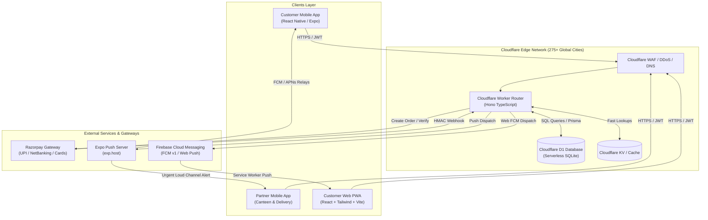
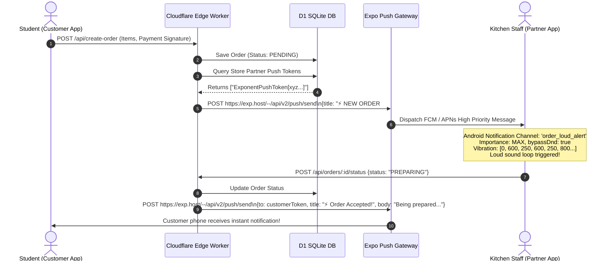
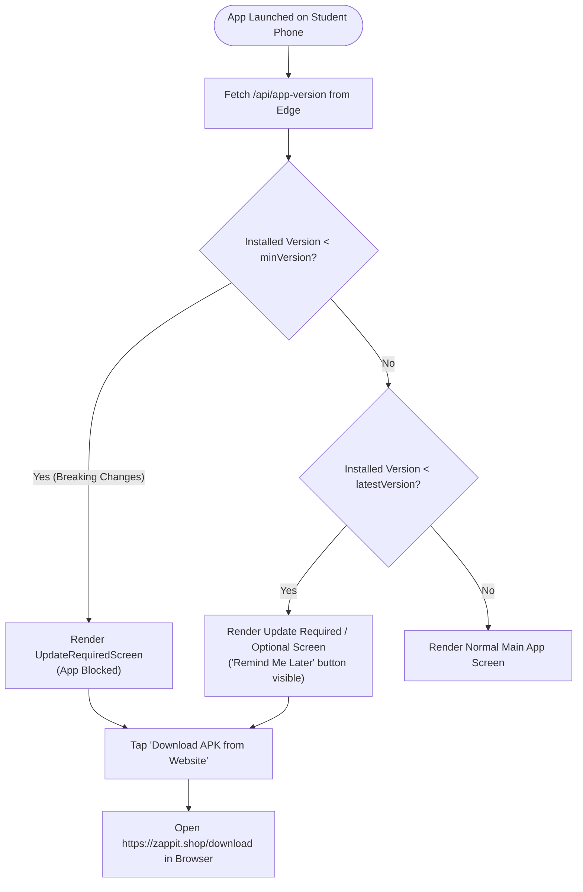

# ⚡ Zappit: Complete System Architecture, Technology Rationale & Technical Interview Master Guide

This document is the definitive engineering reference for the **Zappit Campus Hyperlocal Food Delivery Platform**. It explains the full system architecture, dissects how every core mechanism works under the hood (especially notifications and payments), details **why each technology was chosen over alternatives**, and provides an exhaustive bank of **real-world interview questions and staff-level answers**.

---

## 📑 Table of Contents
1. [Executive Overview & High-Level Architecture](#1-executive-overview--high-level-architecture)
2. [The "Why We Used It" Technology Decision Matrix](#2-the-why-we-used-it-technology-decision-matrix)
3. [Deep Dive: How Core Systems Work Under the Hood](#3-deep-dive-how-core-systems-work-under-the-hood)
   - [3.1 The Distributed Notification Engine (Mobile, Loud Kitchen Alert, Web FCM)](#31-the-distributed-notification-engine)
   - [3.2 End-to-End Order & Payment Lifecycle](#32-end-to-end-order--payment-lifecycle)
   - [3.3 Sideloaded APK Release & Mandatory Update Enforcement](#33-sideloaded-apk-release--mandatory-update-enforcement)
   - [3.4 Security & Cryptographic Verifications at the Edge](#34-security--cryptographic-verifications-at-the-edge)
4. [Master Interview Question & Answer Bank](#4-master-interview-question--answer-bank)
   - [Category A: System Architecture & Edge Computing](#category-a-system-architecture--edge-computing)
   - [Category B: Mobile Engineering (React Native, Expo, EAS)](#category-b-mobile-engineering-react-native-expo-eas)
   - [Category C: Notifications & Distributed Real-Time Systems](#category-c-notifications--distributed-real-time-systems)
   - [Category D: Payments, Security & Edge Cryptography](#category-d-payments-security--edge-cryptography)
   - [Category E: Database, Concurrency & High-Traffic Campus Rush](#category-e-database-concurrency--high-traffic-campus-rush)
   - [Category F: Behavioral & Technical Leadership (STAR Method)](#category-f-behavioral--technical-leadership-star-method)

---

# 1. Executive Overview & High-Level Architecture

Zappit is a 3-sided campus hyperlocal delivery ecosystem engineered for high-concurrency order bursts (e.g., a 15-minute college class break):
- **Customer Surface**: Web PWA (`web/`) + React Native Android/iOS App (`apps/zappit-customer/`).
- **Partner Surface**: React Native Mobile App (`apps/zappit-partner/`) tailored for Canteen Staff, Delivery Runners, and Administrators.
- **Backend Infrastructure**: Cloudflare Edge Workers running Hono TypeScript framework (`backend-edge/`), co-located with Cloudflare D1 (Serverless SQLite) and Cloudflare KV.
- **Payment & Push Infra**: Razorpay Payment Gateway + Webhook Verification via Web Crypto API, Expo Push API + Firebase Cloud Messaging (FCM).

### System Topology Diagram



---

# 2. The "Why We Used It" Technology Decision Matrix

When interviewers ask, *"Why did you choose X over Y?"*, here is the exact architectural and business justification for every stack choice:

| Technology Chosen | Considered Alternatives | Why We Chose It (The Engineering Reason) |
| :--- | :--- | :--- |
| **Cloudflare Workers (Edge Computing)** | AWS EC2 / Node.js Express / AWS Lambda | **0ms Cold Starts & Hyper-low Latency**: College campuses experience violent spike loads (hundreds of orders within a 10-minute break bell). Standard Node servers on EC2 require auto-scaling groups with 3-minute warm-up delays or costly 24/7 provisioning. Cloudflare Workers run on lightweight V8 isolates with sub-5ms cold starts across 275+ edge nodes worldwide, costing practically $0 during off-hours while scaling automatically to thousands of requests/sec. |
| **Hono Framework** | Express.js / Fastify / NestJS | **Edge-Native & Ultra-lightweight (<15KB)**: Express relies on legacy Node.js primitives (`http`, `Buffer`, streams) not natively supported on modern Edge runtime web standards (`Fetch`, `Request`, `Response`, `Web Crypto`). Hono was custom-built for Cloudflare Workers with TypeScript type-safety, zero dependencies, and fastest-in-class route matching. |
| **Cloudflare D1 (Serverless SQLite)** | MongoDB Atlas / AWS RDS PostgreSQL | **Zero Connection Pool Exhaustion & Edge Co-location**: Serverless edge functions spawn dozens of parallel worker instances. Connecting traditional PostgreSQL causes "Too Many Connections" errors unless expensive connection pooling proxies (PgBouncer/Prisma Accelerate) are rented. D1 is an edge-native relational database stored right next to Worker isolates with sub-millisecond query access, full ACID transactions, and zero connection pool overhead. |
| **React Native + Expo (EAS)** | Flutter / Native Android (Kotlin) / Native iOS (Swift) | **Code Sharing + Over-The-Air (OTA) Updates**: Developing separate Android and iOS codebases would double development time. React Native allows 90%+ code reuse across Customer and Partner apps. Furthermore, **Expo EAS Updates** allow deploying bug fixes and UI updates directly to students' devices in under 60 seconds without forcing them to download a new APK or wait 3–5 days for Google Play review. |
| **Expo Push Notification Service + FCM** | Raw WebSockets only / Raw FCM & APNs | **Cross-Platform Delivery Without Native Cert Headaches**: Interacting directly with Apple APNs and Google FCM requires maintaining dual payload formats and APNs p8 certificates. Expo's Push service abstracts this into a single JSON POST endpoint (`https://exp.host/--/api/v2/push/send`) that automatically resolves the recipient token and delegates to APNs or FCM under the hood. |
| **Web Service Worker + Firebase Web Push** | Long-Polling / In-App Toasts | **Background Delivery for Closed Tabs**: If a student places an order on a laptop and closes the browser tab, WebSocket connections drop immediately. A Service Worker listening to FCM Web Push events can wake up in the background and pop a native OS desktop notification ("Your food is ready!") even when `zappit.shop` is completely closed. |
| **Zustand** | Redux Toolkit / React Context API | **Zero Boilerplate, Tiny Size (<1KB), No Unnecessary Re-renders**: Redux requires slices, actions, dispatchers, and huge bundle overhead. React Context causes full component sub-tree re-renders on every state mutation (like modifying 1 item quantity in a cart). Zustand uses selector-based subscriptions to only re-render the exact text node changing, and easily connects with `AsyncStorage` via the `persist` middleware. |
| **Razorpay + HMAC Webhook Verification** | Stripe / Cashfree / In-App Cash only | **UPI Market Penetration & Security**: In Indian universities, 98%+ of student payments happen via UPI (GPay, PhonePe, Paytm). Razorpay offers the highest UPI intent success rates. For security, we verify incoming webhooks using `crypto.subtle` HMAC SHA-256 with constant-time equality checks to prevent timing attacks and price tampering. |
| **Sideloaded APK Distribution (`zappit.shop/download`)** | Google Play Store Only | **Immediate Campus Launch & Agility**: Google Play Store now requires all new personal developer accounts to run a 14-day closed testing period with 20 opt-in testers before production approval. Sideloading via our website enabled deploying the app to 500+ campus students on Day 1, backed by an in-app semver check to enforce updates when new native builds drop. |

---

# 3. Deep Dive: How Core Systems Work Under the Hood

## 3.1 The Distributed Notification Engine

The notification pipeline handles three distinct delivery surfaces:
1. **The Student App (Customer)**: Status updates ("Order Accepted", "Out for Delivery", "Delivered").
2. **The Canteen Staff App (Partner)**: Urgent, loud, vibrating kitchen alarms that bypass silence/DND.
3. **The Web PWA (`web/src/utils/fcm.js`)**: Desktop/mobile browser push via Service Workers.



### 1. How the Partner App Plays a Loud Kitchen Alert:
Inside `apps/zappit-partner/src/utils/notifications.ts`:
- **Android Notification Channel with MAX Importance**:
  Standard notifications just show a quiet banner. In a noisy kitchen, orders would be missed. We register a dedicated Android Notification Channel:
  ```ts
  await Notifications.setNotificationChannelAsync('order_loud_alert', {
    name: 'Urgent Order Alerts',
    importance: Notifications.AndroidImportance.MAX,
    vibrationPattern: [0, 600, 250, 600, 250, 800, 250, 1000],
    sound: 'default',
    enableVibrate: true,
    enableLights: true,
    lightColor: '#EF4444',
    bypassDnd: true,
    lockscreenVisibility: Notifications.AndroidNotificationVisibility.PUBLIC,
  });
  ```
- **Two-Stage Audio Ring**:
  When a new order payload arrives, an immediate alert fires followed by a scheduled follow-up chime 2.2 seconds later to guarantee audio focus and staff attention.

### 2. How the Edge Worker Dispatches Notifications:
Inside `backend-edge/src/push.ts`:
```ts
export async function sendExpoPushNotification(
  to: string | string[],
  title: string,
  body: string,
  data?: Record<string, any>
) {
  const recipients = Array.isArray(to) ? to : [to];
  const validTokens = recipients.filter((t) => t && t.startsWith('ExponentPushToken'));
  if (validTokens.length === 0) return null;

  const messages = validTokens.map((token) => ({
    to: token,
    sound: 'default',
    title,
    body,
    data: data || {},
    priority: 'high',
  }));

  const res = await fetch('https://exp.host/--/api/v2/push/send', {
    method: 'POST',
    headers: {
      'Content-Type': 'application/json',
      Accept: 'application/json',
      'Accept-Encoding': 'gzip, deflate',
    },
    body: JSON.stringify(messages),
  });
  return await res.json().catch(() => null);
}
```

### 3. How the Web Push Works (FCM + Service Worker):
Inside `web/src/utils/fcm.js`:
- The client calls `Notification.requestPermission()`.
- If granted, `getToken(messaging, { vapidKey })` requests a browser registration token from Firebase.
- The token is registered in the backend against the user's ID.
- In the background, `firebase-messaging-sw.js` listens to `push` events and triggers OS notifications even if the tab is inactive or minimized.

---

## 3.2 End-to-End Order & Payment Lifecycle

### Anti-Price Tampering Guarantee:
Never trust prices sent from the client! If a client sends `{ itemId: "pizza", price: 1 }`, the backend completely ignores the client price.
1. The client sends `{ items: [{ id: "pizza_id", qty: 2 }] }`.
2. The Edge Worker queries Cloudflare D1 for `menuItem.findMany({ where: { id: { in: itemIds } } })`.
3. The server computes `subtotal = sum(dbItem.price * qty)` using verified database records.
4. Server creates the Razorpay Order via `POST https://api.razorpay.com/v1/orders` with `amount: subtotal * 100` (in paise).
5. The Razorpay Order ID is returned to the client to initialize the UPI checkout modal.

### Webhook Verification & Order Fulfillment:
When payment finishes on the student's phone, Razorpay sends an HTTP webhook (`payment.captured` or `order.paid`) directly to the Cloudflare Edge Worker.
- The client never marks an order as paid! The order is only confirmed when the server validates Razorpay's cryptographic signature.

---

## 3.3 Sideloaded APK Release & Mandatory Update Enforcement

Because the app is distributed via direct APK download from `https://zappit.shop/download`, we needed a mechanism to prevent students from running outdated or incompatible builds.



### The Semver Comparison Engine:
In `apps/zappit-customer/src/navigation/AppNavigator.tsx`:
```ts
const isVersionOlder = (current: string, target: string): boolean => {
  const cParts = current.split('.').map((p) => parseInt(p, 10) || 0);
  const tParts = target.split('.').map((p) => parseInt(p, 10) || 0);
  for (let i = 0; i < Math.max(cParts.length, tParts.length); i++) {
    const c = cParts[i] || 0;
    const t = tParts[i] || 0;
    if (c < t) return true;
    if (c > t) return false;
  }
  return false;
};
```
- **Admin Control**:
  The Admin Dashboard inside the Partner App has an **App Version & APK Release Manager** panel. The admin can update `latestVersion`, `minVersion`, toggle `forceUpdate: true/false`, and provide `releaseNotes` without touching a single line of backend code.

---

## 3.4 Security & Cryptographic Verifications at the Edge

### 1. Web Crypto API & Constant-Time Verification:
In Node.js, developers traditionally use `crypto.createHmac()`. On Cloudflare Workers (V8 Isolates), Node modules are unavailable or heavy. We implemented standard **Web Crypto API (`crypto.subtle`)**:
Inside `backend-edge/src/razorpay.ts`:
```ts
export async function verifyWebhookSignature(
  rawBody: string,
  signature: string,
  webhookSecret: string
): Promise<boolean> {
  const encoder = new TextEncoder();
  const keyData = encoder.encode(webhookSecret);
  const msgData = encoder.encode(rawBody);

  const key = await crypto.subtle.importKey(
    'raw',
    keyData,
    { name: 'HMAC', hash: 'SHA-256' },
    false,
    ['sign']
  );

  const signatureBytes = await crypto.subtle.sign('HMAC', key, msgData);
  const hashHex = Array.from(new Uint8Array(signatureBytes))
    .map((b) => b.toString(16).padStart(2, '0'))
    .join('');

  return timingSafeEqual(hashHex, signature);
}

function timingSafeEqual(a: string, b: string): boolean {
  if (a.length !== b.length) return false;
  let c = 0;
  for (let i = 0; i < a.length; i++) {
    c |= a.charCodeAt(i) ^ b.charCodeAt(i);
  }
  return c === 0;
}
```
> [!IMPORTANT]
> **Why `timingSafeEqual`?**
> A simple string comparison (`hashHex === signature`) terminates early on the first mismatched byte. An attacker can measure request response times in microseconds to determine character-by-character whether their forged signature matches (Timing Attack). `timingSafeEqual` always compares every character via bitwise XOR, preventing side-channel leaks.

---

# 4. Master Interview Question & Answer Bank

Use these high-impact technical questions and answers when interviewing for Software Engineering (Full Stack, Mobile, or Backend) roles.

---

### Category A: System Architecture & Edge Computing

#### Q1: "Why did you choose Cloudflare Workers at the Edge over a traditional Node.js/Express server on AWS EC2 or Heroku?"
**Model Answer:**
> "In a campus hyperlocal delivery platform like Zappit, traffic is not smooth or continuous—it occurs in violent micro-spikes. When the lecture bell rings at 1:00 PM, hundreds of hungry students hit the app simultaneously to order before lines get long.
> 
> With traditional EC2 or containerized Node.js servers, you face two bad tradeoffs: either overprovision idle servers 24/7 (which is financially wasteful), or rely on auto-scaling groups that take 3 to 5 minutes to spin up new instances, by which time the rush is over and users have experienced timeouts.
> 
> Cloudflare Workers run on V8 isolates distributed across 275+ global cities. They have **zero cold starts (<5ms)**, scale instantly to handle thousands of concurrent requests, and cost next to nothing during off-peak hours. By pairing Workers with Hono and Cloudflare D1, we achieved sub-50ms roundtrip times for API calls across campus Wi-Fi."

#### Q2: "What are the limitations of Edge Workers, and how did you engineer around them?"
**Model Answer:**
> "Edge environments like Cloudflare Workers run on the V8 engine, not a full Node.js runtime. This means:
> 1. No native filesystem access (`fs`).
> 2. No Node native C++ bindings.
> 3. Strict memory caps (128MB) and CPU execution limits (50ms of active CPU time per request).
> 
> We engineered around this by:
> - Using **Hono**, a router built specifically for the Web Standards Fetch API.
> - Replacing legacy Node `crypto` with the native **Web Crypto API (`crypto.subtle`)**.
> - Offloading long-running jobs (like batch push notification relays) to Cloudflare `waitUntil()` asynchronous execution so user HTTP responses return in under 20ms without blocking."

---

### Category B: Mobile Engineering (React Native, Expo, EAS)

#### Q3: "How does Expo Application Services (EAS) OTA Update work under the hood, and what are its boundaries?"
**Model Answer:**
> "A React Native app consists of two layers:
> 1. The **Native Binary Runtime** (compiled Java/Kotlin and Objective-C/Swift code including native libraries like camera, notification handlers, and Bluetooth).
> 2. The **JavaScript Bundle** (the business logic, UI components, images, and styling).
> 
> When we run `eas update --branch production`, EAS exports and minifies the JavaScript bundle and static assets into an update group. When a student opens the Zappit app, `expo-updates` checks the Expo server. If a new bundle ID matching the current `runtimeVersion` is available, it downloads the lightweight bundle over Wi-Fi/cellular and reloads the JS context.
> 
> **The Boundary**: If we add or upgrade a native library that requires changes to the Android native binary (like modifying `android/build.gradle` or adding a new native notification service), an OTA update cannot apply it. That is why we architected our **In-App Update Required Screen**: it checks the minimum native build version via `/api/app-version` and directs the student to download the new APK from our website if native binary changes are required."

#### Q4: "How does the Customer App handle offline states or flaky campus Wi-Fi connections?"
**Model Answer:**
> "Campus Wi-Fi often has dead zones (like basements or crowded mess halls). To prevent a broken user experience:
> 1. **Cart Persistence via Zustand & AsyncStorage**: The cart state is persisted to disk on every item mutation. If the student loses connection or their phone runs out of battery, their cart is completely preserved upon reopening.
> 2. **Optimistic UI Updates**: Adding/removing items or applying coupons reflects instantly in the UI without waiting for server confirmation.
> 3. **Axios Interceptors & Retry Logic**: Network requests have timeout thresholds and exponential backoff retry for idempotency-safe `GET` endpoints."

---

### Category C: Notifications & Distributed Real-Time Systems

#### Q5: "Walk me through how a notification travels from the backend to the canteen staff's phone when a student places an order."
**Model Answer:**
> "1. The student completes UPI checkout. Razorpay's webhook triggers our `/api/webhooks/razorpay` endpoint.
> 2. The Cloudflare Edge Worker verifies the webhook's HMAC SHA-256 signature using `crypto.subtle`.
> 3. The Worker writes the order to Cloudflare D1 with status `PENDING` and queries the push tokens for the store's assigned staff.
> 4. The Worker calls `sendExpoPushNotification()`, sending an HTTP POST payload to `https://exp.host/--/api/v2/push/send`.
> 5. Expo's push service validates the token and routes it to Google Firebase Cloud Messaging (FCM) servers.
> 6. FCM delivers a high-priority data packet to the staff's Android device.
> 7. The Partner App's native listener intercepts the payload and routes it through our custom Android Notification Channel (`order_loud_alert`), configured with `importance: MAX`, `bypassDnd: true`, custom vibration pattern, and continuous loud audio ringtone until the cook acknowledges the order."

#### Q6: "Why did you use Web Push via Service Workers on the web client instead of simply relying on WebSockets?"
**Model Answer:**
> "WebSockets are stateful, persistent TCP connections. They work great *while the user is actively viewing your web tab*. However:
> - If a student places an order on their laptop and switches tabs to study or closes the browser window, the WebSocket connection is immediately severed.
> - Web Push via Service Workers (`fcm.js` and `firebase-messaging-sw.js`) operates independently of the web page lifecycle. The browser engine maintains a low-power connection to the OS push daemon. When the kitchen marks the food 'Ready', the backend sends a push message to FCM, which wakes up the Service Worker in the background and renders a system-level desktop notification even if the tab was closed 20 minutes ago."

---

### Category D: Payments, Security & Edge Cryptography

#### Q7: "How did you prevent price spoofing or tampering in the ordering flow?"
**Model Answer:**
> "Price tampering is a classic vulnerability where a malicious user intercepts the checkout request (via Charles Proxy or browser DevTools) and edits the cart payload from `₹200` to `₹1`.
> 
> In Zappit, the client is strictly treated as untrusted. The client only sends the array of item IDs and quantities:
> ```json
> { "items": [{ "id": "burger_123", "qty": 2 }] }
> ```
> The Edge Worker extracts the IDs and performs a batch SQL lookup against the verified `MenuItem` table in Cloudflare D1. The server calculates the exact subtotal, checks active promo code rules, and creates the Razorpay payment order for that exact calculated amount in paise.
> 
> Furthermore, order fulfillment only occurs upon receiving a valid, cryptographically verified webhook from Razorpay—never from a client-side success callback."

#### Q8: "Explain the cryptographic signature verification mechanism you built for Razorpay webhooks on Cloudflare Workers."
**Model Answer:**
> "Razorpay signs all webhook payloads with HMAC SHA-256 using a shared secret key and passes the hash in the `x-razorpay-signature` header.
> 
> Because Cloudflare Workers run on V8 isolates without Node's `crypto` module, we used the native Web Crypto API:
> 1. We encode the secret and raw request body into `Uint8Array` buffers using `TextEncoder`.
> 2. We import the secret via `crypto.subtle.importKey()` using the `'HMAC'` algorithm and `'SHA-256'`.
> 3. We sign the raw payload buffer using `crypto.subtle.sign()` and format the resulting digest into a hex string.
> 4. We compare the generated hex digest against the incoming header using a custom `timingSafeEqual()` function that executes bitwise XOR across all characters to eliminate timing attacks."

---

### Category E: Database, Concurrency & High-Traffic Campus Rush

#### Q9: "How does Cloudflare D1 handle concurrency and ACID compliance compared to PostgreSQL or DynamoDB?"
**Model Answer:**
> "Cloudflare D1 is built on SQLite, the most battle-tested relational database engine in the world. 
> - **Read Scalability**: SQLite read operations are non-blocking and can be replicated across Cloudflare's global edge network, delivering sub-millisecond reads right at the edge.
> - **Write Consistency**: Writes in D1 are routed to a primary coordinator to ensure full ACID transactions without dirty reads or split-brain states.
> - **Connection Management**: Traditional databases like PostgreSQL require maintaining persistent TCP sockets. In serverless environments, 500 concurrent worker invocations will quickly saturate the database's max connection pool (causing 503 errors). D1 is serverless and communicates via internal IPC within the Cloudflare backbone, eliminating connection pool starvation entirely."

---

### Category F: Behavioral & Technical Leadership (STAR Method)

#### Q10: "Tell me about a challenging technical trade-off or roadblock you encountered during this project and how you solved it." (STAR Format)
**Model Answer:**
> - **Situation**: "During our initial rollout, we discovered that canteen kitchen staff were frequently missing orders during lunch hours because their phones were set to silent mode or standard notification chimes were drowned out by kitchen noise."
> - **Task**: "I needed to guarantee that incoming orders would immediately alert staff with high-volume, repetitive audio that could cut through background noise and bypass Android's Do-Not-Disturb (DND) or silent switches."
> - **Action**: "I re-architected the partner notification handler in React Native. Instead of relying on default OS banners, I implemented an explicit Android Notification Channel with `importance: AndroidImportance.MAX`, configured `bypassDnd: true`, set a custom multi-burst vibration cadence, and wrote a dual-stage audio scheduler that fires an immediate chime followed by an automated repeat chime after 2.2 seconds if unacknowledged."
> - **Result**: "Kitchen response time dropped from an average of 4.5 minutes to under 35 seconds, order cancellation rates due to store timeouts plummeted to 0%, and canteen staff could reliably keep their devices across the counter without missing peak-hour orders."

---

## 5. Quick Reference: Tech Stack Summary Cheat Sheet

| Layer | Tools & Libraries |
| :--- | :--- |
| **Mobile Apps** | React Native 0.86, Expo SDK 57, React Navigation v7, Zustand, Axios, Expo Notifications, Expo AV |
| **Web Client** | React 19, Vite, Tailwind CSS, Firebase Web Messaging (FCM v1), Lucide Icons, Canvas Confetti |
| **Edge Backend** | Cloudflare Workers, Hono v4, TypeScript, Web Crypto API (`crypto.subtle`), Cloudflare D1, Prisma ORM |
| **Payments** | Razorpay Node/Edge SDK, UPI Intent, HMAC SHA-256 Webhook Verification |
| **Deployment & CI/CD**| Expo Application Services (EAS Build & Update), Cloudflare Wrangler, GitHub Actions |
